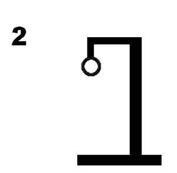

# Galgje – Git Collaboration

**Team:** <Teamnaam>  
**Spelvolgorde & contact:**
1. <Aloys 1> – <email1@example.com>
2. <Jayden 2> – <email2@example.com>
3. <Kichaira 3> – <email4@example.com>

---

## Woordraster
<!-- Pas het aantal kolommen aan aan de woordlengte -->
| . | A | . | . | . | . |
| - | - | - | - | - | - |
| 1 | 2 | 3 | 4 | 5 | 6 |

## Status

---

## Beurtenlog
- beurt1: <Aloys> gokt "A" * is goed
- beurt2: <Jayden> gokt "F" * nuh uh
- beurt3: <kichaira> gokt "o"